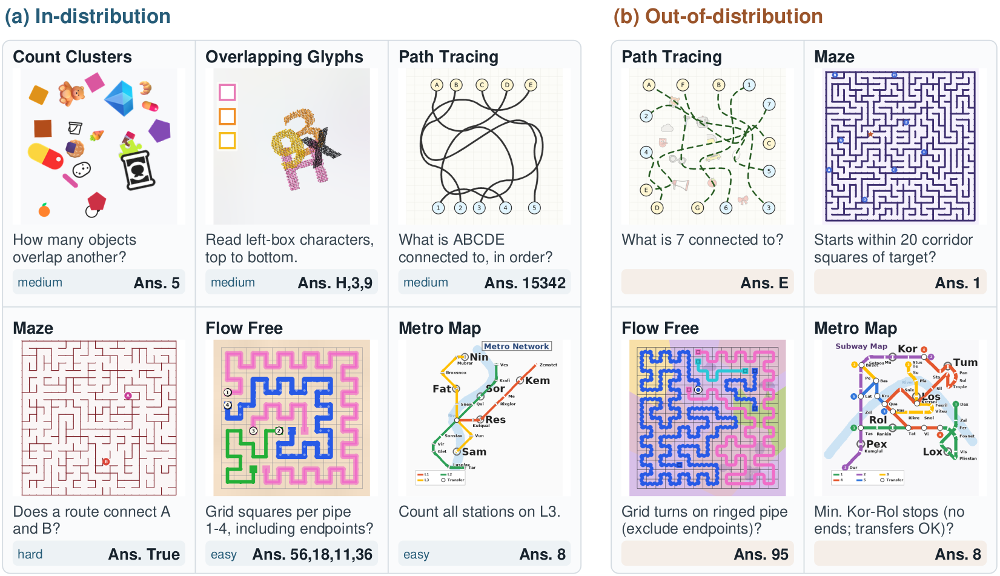

# VisRO: A Data Pipeline for Vision-Centric Reasoning

[](https://arxiv.org/abs/2610.21323)&nbsp;
[](https://huggingface.co/datasets/Lyy0725/VisRO)&nbsp;
[](LICENSE)&nbsp;

This is the official generator of VisRO (release 1.0.0), the procedural dataset introduced in the paper [AdaLoop: Thinking with the Vision Encoder](https://arxiv.org/abs/2610.21323), together with the `visro` package that reads and scores the published dataset. The generator runs on CPUs; the reader and the scorer need only Python 3.10+ and Pillow.

This repository contains the dataset code and assets. The AdaLoop models live in the separate [AdaLoop repository](https://github.com/xrhan/AdaLoop). VisRO has no AdaLoop, PyTorch or JAX dependency. All commands below run from this repository's root.

## Overview

VisRO has 24 visual reasoning tasks in four categories. Every example is one image, one question and one short reference answer. Each task has four difficulty levels for training and in-distribution evaluation (easy, medium, hard, xhard) and a harder fifth level (xxhard) held out for out-of-distribution evaluation. The paper's experiments use six tasks, VisRO-Core6: `count_clusters`, `flow_free`, `maze`, `metro_map`, `overlapping_glyphs` and `path_tracing`.

<p align="center">
  
</p>

The task folders follow the four categories in **Appendix E.1** of the [paper](https://arxiv.org/html/2610.21323#A5.SS1):

| Folder under `tasks/` | Paper category | Tasks |
| --- | --- | ---: |
| `discrimination_grouping/` | Discrimination and grouping | 7 |
| `paths_connectivity/` | Paths and connectivity | 4 |
| `planar_transformations/` | Planar transformations and composition | 6 |
| `spatial_transformations/` | Spatial transformations and structure | 7 |

Each task directory holds `adapter.py`, `verifier.py`, `generator/` and a README. `shared/` holds libraries used by several tasks, `assets/` fonts, icons and fitted inputs, and `visro/` the common workflow and the reader and scorer. [docs/TASKS.md](docs/TASKS.md) lists every task and tier, and [docs/STRUCTURE.md](docs/STRUCTURE.md) describes the tree.

## Dataset

The published dataset is on [Hugging Face](https://huggingface.co/datasets/Lyy0725/VisRO): 2,428,800 examples in 528 WebDataset tar shards, with 100,000 `train`, 600 `eval` and 600 `ood` examples per task. Each example is a `<key>.json` record (12 fields: id, task, category, split, difficulty, question, answer, answer type, options, image name, image hash, image size) followed by its `<key>.png` image. [docs/DATASET.md](docs/DATASET.md) describes the layout, the record schema and the scoring rules.

Download all of it, or one split at a time:

```bash
hf download Lyy0725/VisRO --repo-type dataset --local-dir data/VisRO
hf download Lyy0725/VisRO --repo-type dataset --local-dir data/VisRO --include "tasks/*/*/eval/*"
hf download Lyy0725/VisRO --repo-type dataset --local-dir data/VisRO --include "tasks/*/*/ood/*"
```

The dataset also loads with Hugging Face `datasets`, either all tasks (`default`) or one task per configuration:

```python
from datasets import load_dataset

ds = load_dataset("Lyy0725/VisRO", "maze", split="eval")
row = ds[0]
row["png"]                                     # the image (PIL)
row["json"]["question"], row["json"]["answer"]
```

## Zero-Shot Results

Large vision-language models evaluated zero-shot on VisRO-Core6 (Table 1 of the [paper](https://arxiv.org/abs/2610.21323)). Scores are exact-match accuracy (%) on a stratified 10% subset of the test splits: 720 items, with 60 in-distribution items per task (15 per difficulty level) and 60 out-of-distribution items per task. *ID* and *OOD* are macro averages over the six tasks; the task columns are ID accuracy.

| Model | Tok. | `count_clusters` | `flow_free` | `overlapping_glyphs` | `metro_map` | `maze` | `path_tracing` | **ID** | **OOD** |
| --- | ---: | ---: | ---: | ---: | ---: | ---: | ---: | ---: | ---: |
| *Closed models* | | | | | | | | | |
| Gemini 4 Argon (high) | 6,123 | 98.3 | 95.0 | 81.7 | 95.0 | 63.3 | 83.3 | **86.1** | **74.7** |
| GPT-6 Astra (max) | 2,892 | 88.3 | 95.0 | 55.0 | 91.7 | 78.3 | 85.0 | 82.2 | 71.4 |
| Claude Opus 5.5 (max) | 31,146 | 86.7 | 55.0 | 36.7 | 83.3 | 50.0 | 65.0 | 62.8 | 40.0 |
| Grok 4.6 (high) | 20,441 | 36.7 | 0.0 | 36.7 | 33.3 | 31.7 | 36.7 | 29.2 | 15.3 |
| *Open-weight models* | | | | | | | | | |
| Qwen3.5-397B-FP8 | 14,476 | 55.0 | 1.7 | 28.3 | 35.0 | 21.7 | 48.3 | 31.7 | 12.2 |
| DeepSeek-V4.1-Flash (max) | 20,248 | 56.7 | 3.3 | 23.3 | 20.0 | 21.7 | 30.0 | 25.8 | 13.3 |
| InternVL3.5-241B | 3,324 | 21.7 | 1.7 | 28.3 | 28.3 | 26.7 | 13.3 | 20.0 | 11.7 |
| GLM-4.6V | 1,729 | 33.3 | 1.7 | 23.3 | 18.3 | 13.3 | 10.0 | 16.7 | 5.6 |

Each item is one request with the image and the question, followed by an instruction to answer from the image alone and to end with a line `FINAL: <answer>`; only that line is scored, with the task's scoring rules (see [docs/DATASET.md](docs/DATASET.md)). The API models (closed models and DeepSeek-V4.1-Flash) run at their highest available reasoning setting, shown in parentheses, and cannot execute code; no response was cut off by a time limit, and a response that reaches the model's output limit without a final answer counts as wrong. *Tok.* is the average number of generated tokens per completed ID response, including reasoning tokens. On this subset the standard error of the six-task macro average is about 2 points, so rows closer than about 4 points are not reliably ordered. For comparison, AdaLoop fine-tuned on VisRO reaches 64.6 / 75.2 / 61.8 ID and 32.4 / 43.9 / 31.1 OOD with Qwen2.5-VL-3B / PaliGemma2-3B / LLaVA-1.5-7B on the full test splits; see the [AdaLoop repository](https://github.com/xrhan/AdaLoop).

### All 24 Tasks

The five API models above, evaluated with the same protocol on all 24 tasks: 2,880 items, with 60 in-distribution and 60 out-of-distribution items per task. *ID* and *OOD* are macro averages over the 24 tasks, and *Tok.* is computed as above.

| Model | Tok. | **ID** | **OOD** |
| --- | ---: | ---: | ---: |
| Gemini 4 Argon (high) | 10,278 | 87.6 | 73.0 |
| GPT-6 Astra (max) | 4,396 | 92.6 | 80.6 |
| Claude Opus 5.5 (max) | 31,889 | 71.3 | 48.7 |
| Grok 4.6 (high) | 31,253 | 28.3 | 14.0 |
| DeepSeek-V4.1-Flash (max) | 24,047 | 30.1 | 11.0 |

<details>
<summary>Per-task accuracy (ID / OOD)</summary>

| Task | Gemini | GPT | Opus | Grok | DeepSeek |
| --- | ---: | ---: | ---: | ---: | ---: |
| *Discrimination and grouping* |  |  |  |  |  |
| `count_clusters` | 98.3 / 88.3 | 88.3 / 73.3 | 86.7 / 63.3 | 36.7 / 6.7 | 56.7 / 13.3 |
| `count_points_on_lines` | 100.0 / 95.0 | 100.0 / 96.7 | 100.0 / 88.3 | 0.0 / 0.0 | 0.0 / 0.0 |
| `find_the_same` | 96.7 / 86.7 | 88.3 / 78.3 | 80.0 / 53.3 | 23.3 / 0.0 | 41.7 / 0.0 |
| `find_the_different` | 100.0 / 100.0 | 98.3 / 88.3 | 98.3 / 100.0 | 61.7 / 41.7 | 76.7 / 58.3 |
| `find_the_shadow` | 100.0 / 100.0 | 100.0 / 100.0 | 96.7 / 95.0 | 18.3 / 11.7 | 8.3 / 1.7 |
| `overlapping_glyphs` | 81.7 / 53.3 | 55.0 / 33.3 | 36.7 / 16.7 | 36.7 / 11.7 | 23.3 / 3.3 |
| `overlap_match` | 48.3 / 25.0 | 93.3 / 53.3 | 31.7 / 15.0 | 21.7 / 16.7 | 28.3 / 16.7 |
| *Paths and connectivity* |  |  |  |  |  |
| `flow_free` | 95.0 / 90.0 | 95.0 / 100.0 | 55.0 / 36.7 | 0.0 / 0.0 | 3.3 / 0.0 |
| `metro_map` | 95.0 / 93.3 | 91.7 / 76.7 | 83.3 / 63.3 | 33.3 / 11.7 | 20.0 / 20.0 |
| `maze` | 63.3 / 35.0 | 78.3 / 61.7 | 50.0 / 21.7 | 31.7 / 28.3 | 21.7 / 25.0 |
| `path_tracing` | 83.3 / 88.3 | 85.0 / 83.3 | 65.0 / 38.3 | 36.7 / 33.3 | 30.0 / 18.3 |
| *Planar transformations and composition* |  |  |  |  |  |
| `jigsaw_completion` | 100.0 / 65.0 | 95.0 / 71.7 | 51.7 / 0.0 | 0.0 / 0.0 | 1.7 / 0.0 |
| `reconstruction` | 51.7 / 30.0 | 90.0 / 58.3 | 60.0 / 28.3 | 33.3 / 18.3 | 35.0 / 21.7 |
| `tangram_reconstruction` | 100.0 / 98.3 | 98.3 / 90.0 | 96.7 / 36.7 | 13.3 / 0.0 | 20.0 / 0.0 |
| `mirroring_patterns` | 100.0 / 95.0 | 98.3 / 93.3 | 100.0 / 100.0 | 63.3 / 0.0 | 81.7 / 3.3 |
| `rotation_patterns` | 81.7 / 68.3 | 100.0 / 100.0 | 98.3 / 98.3 | 1.7 / 0.0 | 3.3 / 0.0 |
| `logic_matrix` | 98.3 / 98.3 | 96.7 / 20.0 | 71.7 / 0.0 | 28.3 / 0.0 | 28.3 / 0.0 |
| *Spatial transformations and structure* |  |  |  |  |  |
| `count_3d_blocks` | 65.0 / 8.3 | 93.3 / 88.3 | 25.0 / 6.7 | 5.0 / 0.0 | 8.3 / 1.7 |
| `block_delta` | 90.0 / 38.3 | 91.7 / 96.7 | 41.7 / 0.0 | 13.3 / 1.7 | 21.7 / 0.0 |
| `cube_unfold` | 81.7 / 41.7 | 98.3 / 81.7 | 65.0 / 5.0 | 20.0 / 0.0 | 40.0 / 0.0 |
| `paper_folding` | 100.0 / 100.0 | 100.0 / 100.0 | 98.3 / 90.0 | 96.7 / 66.7 | 70.0 / 25.0 |
| `three_d_views` | 93.3 / 88.3 | 100.0 / 100.0 | 95.0 / 96.7 | 45.0 / 13.3 | 40.0 / 16.7 |
| `view_reconstruction` | 96.7 / 95.0 | 98.3 / 98.3 | 76.7 / 81.7 | 28.3 / 38.3 | 40.0 / 13.3 |
| `viewpoint_rotation` | 83.3 / 70.0 | 90.0 / 91.7 | 48.3 / 33.3 | 30.0 / 35.0 | 23.3 / 25.0 |

</details>

For comparison, AdaLoop trained on all 24 tasks reaches 69.5 / 69.9 / 60.6 ID and 25.2 / 24.5 / 21.1 OOD with Qwen2.5-VL-3B / PaliGemma2-3B / LLaVA-1.5-7B on the full test splits.

## Read and Score

Install the reader and the scorer from the repository root (Pillow is the only dependency):

```bash
pip install .
```

`visro.dataset` reads the downloaded shards in place, and `visro.scoring` scores a prediction against a record:

```python
from visro.dataset import iter_examples
from visro.scoring import score_record

for ex in iter_examples("data/VisRO", tasks="core6", split="eval"):   # reads the tar shards directly
    prediction = my_model(ex.image(), ex.record["question"])
    correct = score_record(ex.record, prediction)["correct"]
```

To score a file of predictions (one `{"id": ..., "prediction": ...}` per line):

```bash
visro-score --root data/VisRO --predictions preds.jsonl --tasks core6 --split eval
```

`--per-item` writes the scored rows and `--out` the summary. The scoring rules per task, and how they were checked, are in [docs/DATASET.md](docs/DATASET.md#scoring).

The installed package provides the reader and scorer without the task generators or assets. For model training and evaluation, follow the [AdaLoop installation guide](https://github.com/xrhan/AdaLoop#initialization). Use a separate environment for generation because its dependency pins differ from the model environments.

## Initialization

The generator needs Linux and Python 3.12. Install the Cairo shared library (`libcairo2` on Debian/Ubuntu), then run from the VisRO repository root:

```bash
python3.12 -m venv .venv
. .venv/bin/activate
python -m pip install -r requirements.txt
python generate.py list
```

`pip install -e '.[generate]'` installs the same pinned dependencies together with the package. Prepare the find_the_shadow tables and the Fluent PNGs as described in [docs/ASSETS.md](docs/ASSETS.md); count_clusters needs the Fluent pack for its Fluent and mixed-material examples, and missing assets are never replaced silently.

## Generate and Verify

```bash
python generate.py generate --tasks count_points_on_lines metro_map --tiers easy --n 2 --seed 20261020 --out out/example
python generate.py verify --tasks count_points_on_lines metro_map --tiers easy --root out/example --rebuild 2
python generate.py preview --root out/example --out out/preview --per-tier 2
```

`--tasks` takes task names, a category name, or `all`; `flow_free_count` is an alias for `flow_free`. Every task supports the tiers easy, medium, hard, xhard and xxhard. `python -m visro` is equivalent to `python generate.py` from the repository root. Generation uses the source checkout, including `tasks/`, `shared/` and `assets/`; these directories are not included in the reader/scorer wheel.

Every item is a pure function of (task, tier, split, seed, candidate index). `verify` rebuilds records from those coordinates, compares them byte for byte and re-runs each task's independent verifier; see [REPRODUCING.md](REPRODUCING.md) and [docs/VALIDATION.md](docs/VALIDATION.md).

## Splits

The generator knows four splits: `train`, `eval`, `ood` and an optional `val`. Each split has its own random streams, and `release` keeps later splits disjoint from earlier ones by item and image. The published dataset has no `val` split; it is there for users who want a held-out validation set of their own.

The published layout uses the tiers easy to xhard for `train` and `eval` and the xxhard tier for `ood`. These commands produce that layout with the published per-task counts (25,000 train and 150 eval items per tier, 600 ood items). They generate new items of the same tasks, not the published items themselves (see [REPRODUCING.md](REPRODUCING.md#published-dataset)):

```bash
python generate.py release --tasks all --tiers easy,medium,hard,xhard --out out/visro --n-train 25000 --n-eval 150 --workers 8
python generate.py generate --tasks all --tiers xxhard --split ood --n 600 --out out/visro/ood \
    --exclude-keys-from out/visro/train --exclude-keys-from out/visro/eval --workers 8
python generate.py verify --root out/visro/train --root out/visro/eval --rebuild 3
```

The second command keeps `ood` disjoint from `train` and `eval`. Generating the full train split takes many CPU hours; start with a smaller `--n-train`.

## License

The code is under the Apache License 2.0, see [LICENSE](LICENSE) at the repository root. Bundled icons and fonts keep their own licenses, which also apply to generated images that contain them; see [NOTICE](NOTICE). The published dataset is under CC BY-SA 4.0.

## Citation

If you find this dataset helpful, please cite:

```bibtex
@article{adaloop2026,
  title={AdaLoop: Thinking with the Vision Encoder},
  author={Han, Xinran Nicole and Lu, Yiyang and Gan, Katelyn and Zickler, Todd},
  journal={arXiv preprint arXiv:2610.21323},
  year={2026}
}
```

## Acknowledgements

Many VisRO tasks are procedural counterparts of task types in the BabyVision benchmark (Chen et al., 2026); their layouts, visual styles and answer formats follow BabyVision's examples. VisRO contains no BabyVision images: every image is rendered by the generators in this directory. The maze lattice families are inspired by the maze types in "Thinking with Visual Primitives" (Lu et al., 2026, Sec. 2.4.3).

We thank [Pictogrammers](https://pictogrammers.com/library/mdi/) for Material Design Icons, the artists at [game-icons.net](https://game-icons.net/), and the contributors to [OpenMoji](https://openmoji.org/) for the icon assets used in VisRO's grouping and discrimination tasks, including `find_the_same`, `find_the_different`, and `find_the_shadow`. We also thank [Microsoft Fluent Emoji](https://github.com/microsoft/fluentui-emoji) for the emoji assets used in `count_clusters`, and the [DejaVu Fonts project](https://dejavu-fonts.github.io/) for the fonts used in rendering. Source details and license notices are recorded in [icon sources](assets/icons/SOURCES.md), [font sources](assets/fonts/SOURCES.md), and [NOTICE](NOTICE).
